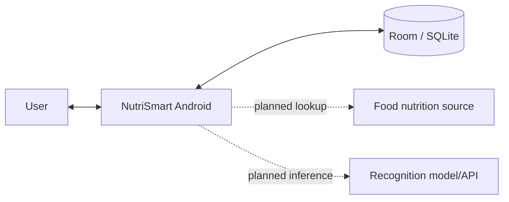
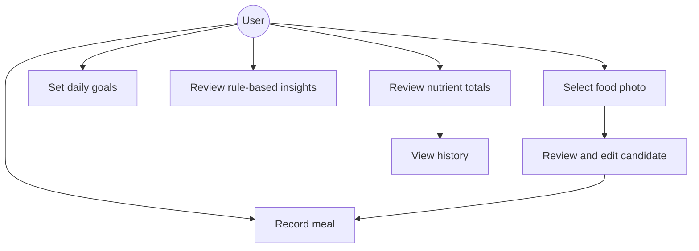
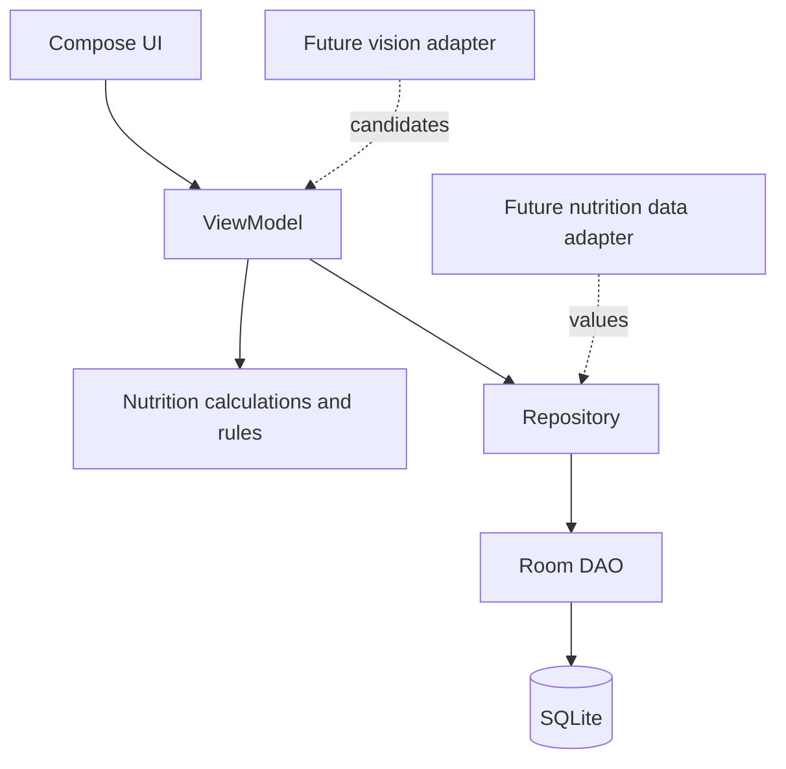

# Architecture Draft
## System context
Actors: user, Android app, local database, future food nutrition source, future image recognition component. First checkpoint runs locally.

## Use cases

## Component diagram

Current flow: UI input → validation → ViewModel → DAO → Room/SQLite → Flow emits records → UI refresh. Browser prototype uses localStorage separately; it is not connected to Android database.
